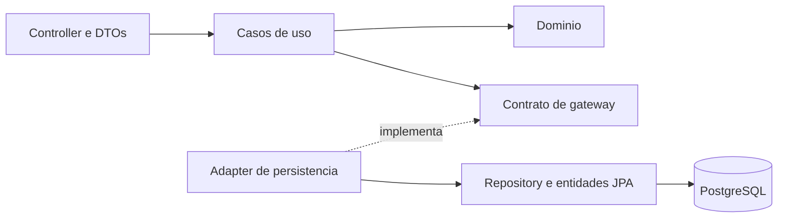
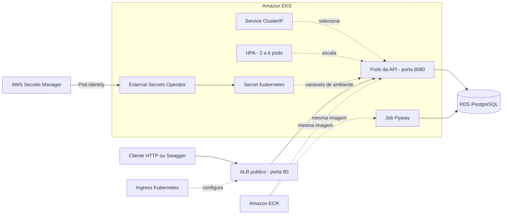
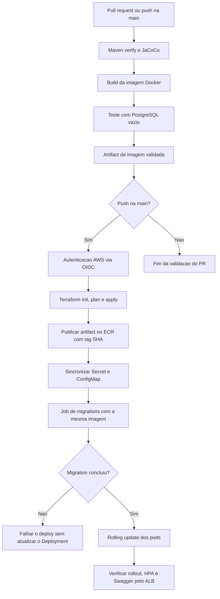

# KAP Mechanics API

API REST para o MVP de gestão de uma oficina mecânica. O sistema centraliza o cadastro de clientes, veículos, serviços, itens de estoque, orçamentos e ordens de serviço, reduzindo controles manuais e dando rastreabilidade ao atendimento.

## Objetivo

Este projeto faz parte do **Tech Challenge da FIAP**, com evolução da aplicação da Fase 1 para a infraestrutura e a entrega automatizada da **Fase 2**. A solução apoia o atendimento da oficina, desde o orçamento até a entrega do veículo, aplicando conceitos de domínio, qualidade e segurança.

Na Fase 2, a API é empacotada em Docker e executada no Amazon EKS, com PostgreSQL no Amazon RDS, acesso público por ALB, escala dos pods por HPA e credenciais no AWS Secrets Manager. O GitHub Actions testa a aplicação, publica a imagem e executa as migrations antes de atualizar os pods.

## Funcionalidades

- Cadastro e manutenção de clientes, veículos e usuários internos.
- Cadastro de serviços e itens de estoque (peças e insumos).
- Registro e consulta de movimentações de estoque.
- Geração e aprovação de orçamentos.
- Inclusão de serviços e itens de estoque no orçamento, com valores congelados.
- Criação de ordens de serviço a partir de orçamentos aprovados.
- Congelamento dos itens aprovados na O.S. e baixa transacional do estoque ao iniciar a execução.
- Acompanhamento dos status da OS: `RECEBIDA`, `EM_DIAGNOSTICO`, `AGUARDANDO_APROVACAO`, `EM_EXECUCAO`, `FINALIZADA` e `ENTREGUE`.
- Persistência e consulta do histórico de status das ordens de serviço.
- Indicador de tempo médio de execução das OS por serviço.
- Autenticação JWT e controle de acesso por perfil: `ADMIN`, `ATENDENTE` e `ESTOQUISTA`.
- Documentação interativa via Swagger/OpenAPI.

## Tecnologias

- Java 21 e Spring Boot 4.1
- Spring Web, Spring Data JPA, Spring Security e Validation
- PostgreSQL 16 e Flyway
- JWT
- Docker e Docker Compose
- Swagger/OpenAPI (Springdoc)
- JUnit, JaCoCo e SonarQube
- Terraform, AWS CLI, Helm e Kubernetes
- AWS EKS, ECR, RDS PostgreSQL, ALB, S3 e Secrets Manager
- GitHub Actions com autenticação AWS via OIDC

## Pré-requisitos

- Docker e Docker Compose para executar o ambiente completo.
- Java 21 para executar a API e os testes diretamente pelo Maven Wrapper.

> O Maven Wrapper está incluído no projeto; não é necessário instalar o Maven globalmente.

## Como executar

1. Inicie o ambiente completo:

   ```powershell
   docker compose up --build
   ```

No ambiente local, as migrations do Flyway são executadas na inicialização. A API ficará disponível em `http://localhost:8080`. No EKS, as migrations são executadas por um Job antes do deploy.

### Execução híbrida (banco em Docker e API local)

Caso prefira depurar a aplicação pela IDE, inicie apenas o banco e execute a API pelo Maven Wrapper:

   ```powershell
   docker compose up -d db
   .\mvnw.cmd spring-boot:run
   ```

> O `Dockerfile` gera o artefato da API em uma etapa de build e a executa em uma imagem Java reduzida. O serviço `app` do `compose.yaml` conecta-se ao PostgreSQL pelo nome do serviço `db`, formando o ambiente completo exigido pelo projeto.

## Arquitetura da aplicação

O código possui contextos em `core` com domínio, casos de uso e contratos de gateways. Controllers recebem as requisições; adapters de persistência conectam esses contratos ao JPA/PostgreSQL; classes de configuração montam as dependências. Também existe um pacote `service`; a conformidade arquitetural deve ser conferida por contexto.

O diagrama representa a organização adotada no contexto Cliente, detalhado no [resumo de migração para Clean Architecture](docs/architecture/migracao-cliente-resumo.md). Ele não substitui a auditoria dos demais contextos.



## Infraestrutura AWS

O ambiente `dev` usa a região `us-east-1`. O Terraform consulta a VPC default e suas sub-redes; ele não cria uma VPC dedicada. O RDS está configurado sem acesso público, com entrada PostgreSQL permitida a partir do security group do EKS.



| Recurso | Configuração atual |
| --- | --- |
| Backend Terraform | S3 com criptografia, versionamento e lockfile. States de bootstrap e dev separados. |
| EKS | Cluster `mechanics-api-dev`, com dois nós desejados no node group. |
| ECR | Repositório `mechanics-api`, tags imutáveis e política de retenção das cinco imagens mais recentes. |
| RDS | PostgreSQL 16, banco `mechanics`, sem acesso público. |
| Deployment | Recursos definidos, rolling update e probes de startup, readiness e liveness. |
| Service e Ingress | Service `ClusterIP` na porta 8080; Ingress cria ALB público com destinos do tipo `ip`. |
| HPA | CPU desejada de 70% e memória de 80% dos requests; mínimo 2 e máximo 6 pods. |
| Segredos | Secrets Manager → External Secrets Operator → Secret Kubernetes, com EKS Pod Identity. |

O HPA controla réplicas da aplicação, não a quantidade de máquinas EC2. Não há autoscaler de nós instalado; aumentar pods exige capacidade disponível no node group.

### Acesso ao ambiente dev

| Recurso | Endereço |
| --- | --- |
| Swagger | [Abrir Swagger público](http://k8s-default-mechanic-9378e9930d-2028155602.us-east-1.elb.amazonaws.com/swagger-ui/index.html) |
| OpenAPI | [Especificação JSON](http://k8s-default-mechanic-9378e9930d-2028155602.us-east-1.elb.amazonaws.com/v3/api-docs) |

Base para requisições:

```text
http://k8s-default-mechanic-9378e9930d-2028155602.us-east-1.elb.amazonaws.com/api
```

As rotas protegidas exigem JWT. O acesso atual é HTTP; domínio, certificado ACM e listener HTTPS ainda precisam ser configurados. O endereço pode mudar se o ALB for recriado.

Com AWS CLI e kubectl autenticados, acompanhe o ambiente pelo PowerShell:

```powershell
aws eks update-kubeconfig --profile SEU_PERFIL_AWS --region us-east-1 --name mechanics-api-dev
kubectl get pods,hpa,ingress -n default -l app=mechanics-api
kubectl get jobs -n default -l app=mechanics-api-migrations
kubectl rollout status deployment/mechanics-api -n default
```

Substitua `SEU_PERFIL_AWS` pelo nome do seu perfil AWS CLI autorizado. Como alternativa administrativa ao ALB:

```powershell
kubectl port-forward -n default service/mechanics-api 8080:8080
```

### Bootstrap e provisionamento

O bootstrap prepara o bucket `mechanics-api-tfstate-<ID_DA_CONTA_AWS>`, uma vez por conta. Ele não é necessário para executar o Compose local. Para administrar a infraestrutura, são necessários Terraform `>= 1.10, < 2.0`, AWS CLI autenticada e permissões específicas de provisionamento.

Para validar os arquivos com os providers já disponíveis:

```powershell
terraform -chdir=infra/terraform/bootstrap init -backend=false
terraform -chdir=infra/terraform/bootstrap validate
terraform -chdir=infra/terraform/environments/dev init -backend=false
terraform -chdir=infra/terraform/environments/dev validate
```

`init -backend=false` serve para validação; não prepara o backend remoto para `plan`/`apply`. Para inicializar o ambiente existente, informe o bucket sem espaços antes ou depois:

```powershell
terraform -chdir=infra/terraform/environments/dev init -reconfigure -backend-config="bucket=mechanics-api-tfstate-SEU-ID-DA-CONTA"
```

As chaves atuais são `bootstrap/terraform.tfstate` e `environments/dev/terraform.tfstate`. Em uma conta nova, o bucket precisa ser criado antes de ativar o backend S3 do bootstrap, seguido da migração do state. Confira os arquivos `backend.tf` ativos antes de seguir o [guia de bootstrap](docs/terraform/terraform-bootstrap.md); o backend real já está versionado neste projeto.

### Credenciais e permissões

O segredo `mechanics-api/dev/application` contém `SPRING_DATASOURCE_PASSWORD` e `JWT_SECRET`. O Terraform gerencia seus metadados; os valores são cadastrados na AWS. O operador usa Pod Identity para sincronizar o Secret `mechanics-api-secrets` no namespace `default`.

A pipeline lê a senha atual do Secrets Manager para preencher `TF_VAR_db_password`. O GitHub Secret `DB_PASSWORD` não é mais utilizado. Alterar somente o segredo não troca a senha no RDS, e pods em execução não recarregam variáveis de ambiente automaticamente. Consulte o [guia de segredos](k8s/secrets-manager.md) para sincronização e rotação.

Não versione credenciais AWS, senhas de ambiente, `secret.local.yaml`, states, planos ou arquivos locais com valores sensíveis. Os JSONs em `infra/iam` descrevem permissões; versioná-los não aplica automaticamente mudanças nas roles.

## CI/CD com GitHub Actions

A configuração está em [.github/workflows/tech-challenge.yml](.github/workflows/tech-challenge.yml). Pull requests para `main` executam testes, build e validação das migrations. Pushes na `main` executam também publicação e deploy.



A imagem é construída uma única vez e transferida como artifact entre os jobs. A publicação no ECR, o Job de migrations e a API usam a mesma imagem validada, com tag do SHA do commit. Execuções da mesma branch não interrompem um deploy em andamento; o controle de concorrência vale dentro de cada repositório.

### Configuração do repositório

Em **Settings → Secrets and variables → Actions → Variables**, configure:

| Variable | Valor esperado |
| --- | --- |
| `AWS_ROLE_ARN` | ARN da role OIDC autorizada para a pipeline. |
| `AWS_REGION` | `us-east-1` para este ambiente. |
| `TF_STATE_BUCKET` | Nome do bucket de state da conta, sem aspas nem espaços extras. |

O trust atual autoriza o fork `KayoLeanndro/17SOAT-TechChallenge1`, na `main`, com subject imutável. O repositório principal `joaoalbuquerq/17SOAT-TechChallenge1` possui outra identidade e não foi autorizado automaticamente. Para usar a mesma AWS a partir dele, prepare seu trust, Variables e arquivos de deploy e defina qual repositório fará as entregas.

OIDC autentica o workflow; as políticas IAM definem o que ele pode fazer. A role atual publica imagens, acessa o state e lê a infraestrutura dev. Ela não recebeu permissões para criar/alterar EKS, RDS, roles IAM ou rede. Embora o workflow execute `terraform apply`, alterações nesses recursos exigem uma identidade de infraestrutura apropriada. Consulte [as políticas de preparação do CI/CD](infra/iam/README.md).

### Migrations no EKS

O Job `mechanics-api-migrate-*` executa a imagem com `--migrate-only`, aplicando o Flyway sem iniciar HTTP ou JPA. Cada deploy cria um nome único; há limite de dez minutos, sem repetição automática após falha, e retenção dos Jobs concluídos por até 24 horas.

O Deployment usa `SPRING_FLYWAY_ENABLED=false` e `SPRING_JPA_HIBERNATE_DDL_AUTO=validate`. A API valida o schema e só recebe a nova imagem após o Job concluir. Uma falha bloqueia o rollout, mas não desfaz mudanças de banco já aplicadas; novas migrations precisam ser compatíveis com os pods anteriores durante a atualização.

Mantenha versionados os scripts, o modo `--migrate-only` em `MechanicsApiApplication.java`, a classe `DatabaseMigrations.java` e todos os SQLs. Não edite migrations já aplicadas. O procedimento completo está no [guia de migrations](k8s/migrations.md).

## Configuração local e primeiro acesso

### Banco local

Por padrão, a aplicação usa o banco criado pelo `compose.yaml`:

| Propriedade | Valor |
| --- | --- |
| Banco | `oficina_db` |
| Usuário | `oficina_user` |
| Porta | `5432` |

Para usar outra instância PostgreSQL, ajuste as propriedades `spring.datasource.*` em `src/main/resources/application.properties`.

### Primeiro acesso local

Em uma base nova, crie o usuário administrador de desenvolvimento abaixo diretamente no PostgreSQL antes de realizar o login:

```sql
INSERT INTO usuario (nome, login, senha_hash, tipo, data_criacao)
VALUES (
    'Administrador Local',
    'admin',
    '$2a$10$Tkvd6E6bTQgy7znCFW3l9eYkH8BZKHbK2XrSw6p8pElb8tz1x1sw6',
    'ADMIN',
    CURRENT_TIMESTAMP
)
ON CONFLICT (login) DO UPDATE
SET nome = EXCLUDED.nome,
    senha_hash = EXCLUDED.senha_hash,
    tipo = EXCLUDED.tipo;
```

Credenciais locais: `admin` / `admin`. Altere ou remova esse usuário fora do ambiente de desenvolvimento.

## Autenticação e documentação da API

O login é realizado em `POST /api/auth/login` com `login` e `senha`. Use o token retornado nas rotas protegidas:

```http
Authorization: Bearer <token>
```

A documentação completa dos endpoints, payloads e respostas está disponível após iniciar a aplicação:

- Swagger UI: `http://localhost:8080/swagger-ui/index.html`
- OpenAPI JSON: `http://localhost:8080/v3/api-docs`

As rotas de autenticação e documentação são públicas; as demais exigem JWT e respeitam as permissões de cada perfil.

## Principais recursos da API

| Recurso | Base da rota |
| --- | --- |
| Autenticação | `/api/auth` |
| Clientes | `/api/cliente` |
| Veículos | `/api/veiculo` |
| Usuários | `/api/usuario` |
| Serviços | `/api/servico` |
| Itens de estoque | `/api/item-estoque` |
| Movimentações de estoque | `/api/movimentacao-estoque` |
| Orçamentos | `/api/orcamento` |
| Ordens de serviço | `/api/ordem-servico` |
| Histórico de status da OS | `GET /api/ordem-servico/{ordemServicoId}/historico-status` |
| Indicadores | `GET /api/indicadores/tempo-medio-execucao/por-servico/{servicoId}` |

### Itens do orçamento e da O.S.

`POST /api/orcamento/{id}/itens` inclui um serviço ou item de estoque em um orçamento
`PENDENTE`. Informe exatamente um de `servicoId` ou `itemEstoqueId`, além de
`quantidade`. O preço é congelado e o total do orçamento é recalculado.

`POST /api/ordem-servico/{id}/itens` inclui um serviço ou item adicional durante
uma O.S. `EM_EXECUCAO`. A inclusão de um item de estoque, inclusive os componentes
de um serviço, registra imediatamente a saída no ledger e reduz o saldo. Ao entrar
em execução, a O.S. copia os itens aprovados do orçamento e baixa seus itens de
estoque de uma só vez.

Para consultar as linhas e o status use `GET /api/orcamento/{id}/itens` ou
`GET /api/ordem-servico/{id}/itens`. Ambas as respostas trazem `status`, `itens`,
quantidade, preço unitário congelado e total da linha; a resposta da OS também
traz o vínculo `orcamentoItemId` quando a linha veio do orçamento.

## Testes e qualidade

### Migrations em PostgreSQL vazio

Com Docker em execução, na raiz do repositório:

```powershell
docker build -t mechanics-api:test-migrations .
python scripts/tests/test-migrations-docker.py mechanics-api:test-migrations
```

O teste cria uma rede e um PostgreSQL temporários, aplica as migrations, repete a execução para verificar idempotência e inicia a API com Hibernate `validate` e Flyway desabilitado. Os containers de teste não publicam portas e são removidos ao final. O RDS não é utilizado. Na pipeline, essa validação tem timeout de cinco minutos; cada execução do modo de migrations no teste tem limite de 60 segundos.

### Testes da aplicação

Execute a suíte de testes:

```powershell
.\mvnw.cmd test
```

Para executar os testes e gerar o relatório de cobertura JaCoCo:

```powershell
.\mvnw.cmd verify
```

O relatório fica em `target/site/jacoco/index.html`.

### SonarQube local

Opcionalmente, inicie o SonarQube local:

```powershell
docker compose --profile quality up -d sonarqube
```

Em seguida, acesse `http://localhost:9000`. No primeiro acesso, entre com `admin` / `admin` e altere a senha solicitada.

Antes da primeira análise, crie manualmente um projeto no SonarQube com a chave:

```text
com.kap:mechanics-api
```

Em **Project settings > Permissions**, conceda ao usuário que executará a análise a permissão **Execute Analysis**. Depois, gere um token em **My Account > Security** e execute:

```powershell
.\mvnw.cmd sonar:sonar "-Dsonar.host.url=http://localhost:9000" "-Dsonar.token=SEU_NOVO_TOKEN"
```

Substitua `SEU_NOVO_TOKEN` pelo token criado nessa instância local do SonarQube. Não use colchetes, links Markdown ou barras (`\\`) no comando. Se o projeto tiver sido criado com outra chave, informe-a explicitamente:

```powershell
.\mvnw.cmd sonar:sonar "-Dsonar.host.url=http://localhost:9000" "-Dsonar.projectKey=SUA_CHAVE_DO_PROJETO" "-Dsonar.token=SEU_NOVO_TOKEN"
```

> Se ocorrer o erro de autorização, confirme se a chave do projeto é `com.kap:mechanics-api` e se o token pertence a um usuário com a permissão **Execute Analysis**. Tokens expostos devem ser revogados e substituídos imediatamente.

## Análise de segurança com OWASP ZAP

O projeto também pode ser analisado com o [OWASP ZAP](https://www.zaproxy.org/), uma ferramenta de teste dinâmico de segurança (DAST). Enquanto o SonarQube analisa o código-fonte, o ZAP verifica a API em execução e gera um relatório visual com alertas, risco, evidência e recomendações.

Com o Docker Desktop em execução, inicie a API localmente. Caso o banco ainda não esteja ativo, inicie-o antes:

```powershell
docker compose up -d db
.\mvnw.cmd spring-boot:run
```

Em outro terminal, na raiz do projeto, execute a análise segura baseada na especificação OpenAPI disponível em `http://localhost:8080/v3/api-docs`:

```powershell
docker run --rm -v "${PWD}:/zap/wrk/:rw" -t ghcr.io/zaproxy/zaproxy:stable zap-api-scan.py -t http://host.docker.internal:8080/v3/api-docs -f openapi -S -r zap-api-report.html -I
```

O relatório será gerado como `zap-api-report.html` na raiz do projeto. Abra-o no navegador para visualizar os achados de segurança.

### Análise autenticada com JWT

A análise anterior cobre principalmente endpoints públicos. Para incluir as rotas protegidas, obtenha um JWT de um usuário local com perfil `ADMIN` e passe-o ao ZAP no header `Authorization: Bearer`.

Em outro terminal PowerShell, com a API ainda em execução, gere o token. Substitua os valores de exemplo pelas credenciais locais e não os adicione ao repositório:

```powershell
$body = @{ login = "SEU_LOGIN_ADMIN"; senha = "SUA_SENHA_ADMIN" } | ConvertTo-Json

$token = (
  Invoke-RestMethod `
    -Method Post `
    -Uri "http://localhost:8080/api/auth/login" `
    -ContentType "application/json" `
    -Body $body
).token

$token.Length
```

Se o último comando retornar um número maior que zero, execute a análise autenticada:

```powershell
docker run --rm `
  -e "ZAP_AUTH_HEADER_VALUE=Bearer $token" `
  -e "ZAP_AUTH_HEADER_SITE=host.docker.internal" `
  -v "${PWD}:/zap/wrk/:rw" `
  -t ghcr.io/zaproxy/zaproxy:stable `
  zap-api-scan.py `
  -t http://host.docker.internal:8080/v3/api-docs `
  -f openapi `
  -S `
  -r zap-api-report-authenticated.html `
  -I
```

O relatório autenticado será gerado como `zap-api-report-authenticated.html` na raiz do projeto. A presença do JWT permite que o ZAP acesse endpoints compatíveis com o perfil usado; respostas `4xx` ainda podem ocorrer quando uma rota exigir IDs ou dados de negócio específicos.

> O parâmetro `-S` executa apenas a análise segura, sem ataques ativos. Para varredura ativa, remova esse parâmetro **somente em ambiente local ou de homologação autorizado**, pois esse modo pode enviar requisições que alteram dados.

## Relatório de segurança

O relatório consolidado de segurança, com escopo, metodologia, resultados do OWASP ZAP, análise dos achados e espaço para a consolidação do SonarQube, está disponível em [docs/security/relatorio-seguranca.md](docs/security/relatorio-seguranca.md).

Os relatórios HTML do ZAP são evidências geradas localmente e não são versionados; gere-os novamente pelos comandos desta documentação sempre que for necessário atualizar a análise.

## Estrutura do projeto

```text
.
├── .github/workflows/tech-challenge.yml    # CI/CD
├── Dockerfile                             # Build e runtime Java
├── compose.yaml                           # API, banco e SonarQube local
├── infra/
│   ├── terraform/bootstrap/               # Bucket de state
│   ├── terraform/environments/dev/        # ECR, EKS, RDS, IAM e rede
│   ├── helm/                              # Valores dos operadores
│   └── iam/                               # Políticas de preparação e do controlador
├── k8s/                                   # Deployment, Job, Service, Ingress, HPA e segredos
├── scripts/                               # Deploy, migrations, ALB e testes Docker
├── docs/                                  # Guias, registros e relatórios
└── src/
    ├── main/java/com/kap/mechanics_api/
    │   ├── core/                          # Contextos: domínio, use cases e gateways
    │   ├── adapter/                       # Implementações de persistência
    │   ├── controller/                    # Endpoints REST
    │   ├── dto/                           # Contratos HTTP
    │   ├── infra/                         # Montagem das dependências
    │   ├── migration/                     # Execução exclusiva do Flyway
    │   ├── repository/                    # Repositórios JPA
    │   ├── service/                       # Serviços existentes
    │   ├── security/                      # JWT e autenticação
    │   └── config/                        # Segurança e OpenAPI
    ├── main/resources/db/migration/       # SQLs Flyway V1 a V6
    └── test/                              # Testes da aplicação
```
